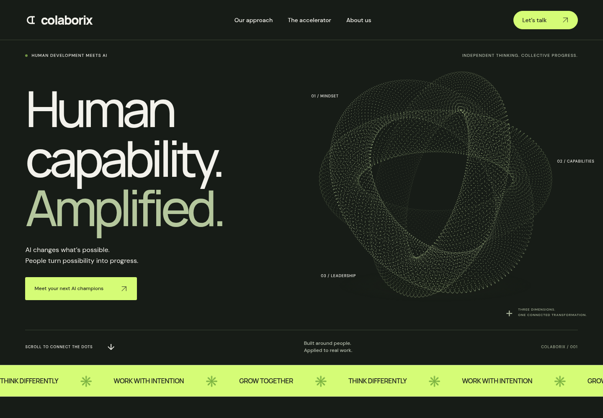

# Colaborix

A responsive B2B website for the AI Champion Accelerator, built with Vite, semantic HTML, CSS, and JavaScript. Fonts are bundled locally. The hero uses a custom Canvas point sculpture; no external imagery, analytics, or AI API is required.

## Saved designs and versions

- Current dark website: [self-contained HTML](versions/colaborix-dark-v1.html). Download **Code → Download ZIP** from GitHub, extract it, and open this file in a browser. No installation is required for this preview.
- [All saved website versions](versions/README.md), including a file manifest and notes about overwritten revisions.
- [Screenshots](screenshots/) of the saved designs.
- [Original uploaded design](references/colaborix_ai_programs.html), retained as reference material.
- [Source snapshot before the dark version](archives/colaborix-before-dark.tar.gz).



## Development

Use Node.js 22.12+ (validated with Node 24).

```sh
cd webOctober26
npm ci --cache /tmp/colaborix-npm-cache
npm run dev
```

## Production

```sh
npm run build
npm run preview
```

Deploy the generated `dist/` directory to a static host.

## GitHub Pages

The deployment workflow builds the current website source from `master` and publishes only `dist/`. Saved HTML versions and reference files remain in the repository; they are not included in the public site.

In **Settings → Pages**, the source is **GitHub Actions**. Each push to `master` deploys automatically. To retry a deployment without changing code, open **Actions → Deploy Colaborix to GitHub Pages → Run workflow** and select `master`.

The configured address is `https://chvojkap.github.io/webOctober26/`. The workflow uses Node 24, `npm ci`, and `GITHUB_PAGES=true npm run build`. This selects the `/webOctober26/` asset base while keeping local development at `/`.

For a custom domain or a renamed repository, update `vite.config.js` to match the new site path before deploying.

## Contact and launch

The enquiry form validates input and creates a copyable message locally. It does not send enquiries or retain data. Before launch, supply an approved contact destination or configure a form delivery service and appropriate privacy information. No testimonials, client logos, extra programs, or business performance claims have been invented.

## Validation

Production build passed. Chromium checks covered desktop (1440px), mobile (390px), no horizontal overflow, axis selection, mobile menu, enquiry generation, reduced-motion content visibility, and absence of JavaScript errors. No automated accessibility audit or external delivery integration has been completed.
